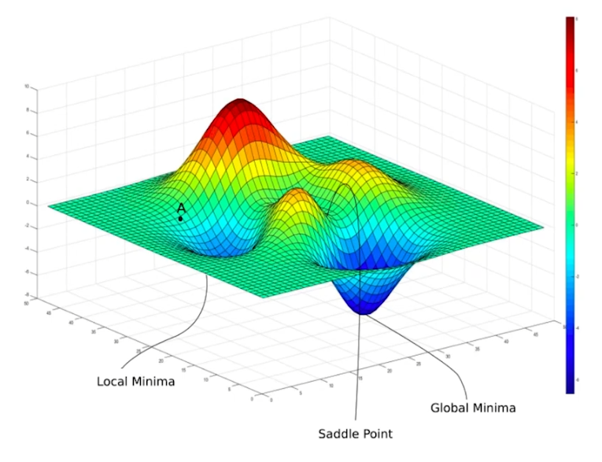

+++
date = '2026-10-27T19:59:24+08:00'
draft = false
title = 'Optimization in Deep learning'
+++

In deep learning, to train whatever the ChatGPT languge model, or image/video generation model, they are all essentially the optimization problem in mathematics.

The optimization cannot only used in ML, but also in other areas like control theory, physics, etc...

```
        Cauchy GD (1847) ──► Mini-batch SGD (Robbins & Monro, 1951)
                                    │
                    ┌────────────┴────────────┐
                    ▼                         ▼
        Polyak Momentum (1964)         AdaGrad (Duchi et al., 2011)
        [Fixes Ravines & Noise]        [Per-parameter adaptive scales]
                    │                         │
        Nesterov Accelerated (1983)    RMSprop (Hinton, 2012)
        ["Look-ahead" damping]         [Fixes decaying LR via EWMA]
                    │                         │
                    └────────────┬────────────┘
                                    ▼
                            Adam (Kingma & Ba, 2014)
                            [Moments + RMSprop + Bias Correction]
                                    │
                    ┌────────────┼────────────┐
                    ▼            ▼            ▼
                    AdamW         Lion         Muon
                (2017)        (2023)       (2024–2026)
                [Decoupled    [Sign + 1st   [Newton-Schulz
                Weight         Moment      Orthogonalized
                Decay]        Memory]       Updates]

```

## Mathematical Prerequisite

We first need intuitive understanding of four specific concepts.

**Multivariable Calculus & Differential Geometry**

3Blue1Brown: Essence of Calculus (visual intuition).

CS229 Lecture Notes on Linear Algebra & Multivariable Calculus (Stanford).

**Moving Statistics & Probability**


**Convex Optimization**

Convex Optimization by Stephen Boyd & Lieven Vandenberghe (Chapters 9–10 on unconstrained minimization). You do not need to read the whole book; focus on Newton’s method, gradient descent convergence, and condition numbers.


The main objective is to minimize the loss function.

$$
\boxed{\theta^*=\arg\min_{\theta} L(\theta)}
$$

### Gradient descent

Gradient descent(GD) was proposed in 1847. people in hundred years later found out this math technique is really useful in machine learning, to train a neural network.

We use gredients computed over the entire training set for each update.

$$
\theta_{t+1}=\theta_t-\eta\,\nabla_\theta L(\theta_t)
$$

Nonconvex landscape:




---

https://goodboychan.github.io/python/deep_learning/tensorflow-keras/2020/09/18/01-Several-Tips-for-Improving-Neural-Network.html


